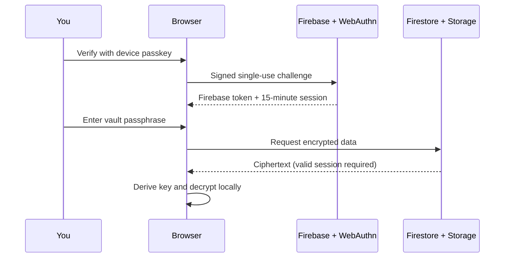

# Haven Vault

A self-hosted, single-owner vault for photos, documents, and notes. A device passkey controls access to Firebase; a separate passphrase decrypts your data in the browser.

Built with React, TypeScript, Vite, Firebase, SimpleWebAuthn, and the Web Crypto API. Released under the [MIT license](LICENSE); bundled third-party images retain their own license.

## Features

- Client-side encryption of files, filenames, notes, metadata, and thumbnails.
- Owner-only Google verification for initial enrollment, then passkey sign-in.
- Photo pinch/wheel zoom and panning, local PDF rendering, and text previews. Office files can be stored and downloaded but have no inline preview.
- Collections, search, favorites, grid/list layouts, trash, and encrypted notes.
- Memory-only authentication, automatic locking, and expiring server sessions.
- Files up to 50 MiB and notes up to 256 KiB.
- A fictional demo that cannot upload real files.

**Security scope:** this is an unaudited personal-vault implementation, not a managed backup service. WebAuthn may use a device PIN instead of biometrics. There is no passphrase reset, passkey-management UI, or built-in backup/export workflow. Read [SECURITY.md](SECURITY.md) and keep independent originals.

## Try it locally

Use Node.js 22.12+ within the Node 22 release line and pnpm 12.0.0.

```sh
git clone https://github.com/i-am-jyotirmaya/haven-vault.git
cd haven-vault
pnpm install --frozen-lockfile
pnpm dev
```

Open **http://127.0.0.1:5173/?demo=1**. No Firebase account or environment file is required for the demo. It is not a local encrypted vault and does not persist your files. The normal sign-in flow requires your own configured Firebase backend.

## Deploy your own vault

Follow the [Firebase setup guide](docs/FIREBASE_SETUP.md). You need a dedicated Firebase project with Blaze billing, Firestore, Storage, Authentication, Hosting, and Cloud Functions. No production credentials or project binding are distributed. Changing frontend variables alone does not configure the security backend.

| Guide | Contents |
| --- | --- |
| [Firebase setup](docs/FIREBASE_SETUP.md) | Installation, environment files, permissions, deployment, and first use |
| [Architecture and integration](docs/ARCHITECTURE.md) | Modules, authentication, storage format, and customization |
| [Troubleshooting](docs/TROUBLESHOOTING.md) | Passkeys, permissions, CORS, and browser warnings |
| [Security](SECURITY.md) | Threat model, recovery limits, and vulnerability reporting |
| [Contributing](CONTRIBUTING.md) | Development and validation |
| [Third-party notices](THIRD_PARTY_NOTICES.md) | Image and dependency licenses |

## Two security layers



First enrollment additionally requires the configured owner's verified Google account. The passphrase never goes to Firebase. A stolen database copy can still be subjected to offline passphrase guessing. An administrator who can deploy malicious JavaScript could capture future unlocks. Protect deployment access as carefully as the vault itself.

## Development checks

```sh
npm --prefix functions ci
pnpm test
pnpm test:config
pnpm test:backend
pnpm test:rules
pnpm build
```

Rules tests require Java 21+ and download Firebase emulators on first use. They use the disposable demo-haven-vault project. The frontend does not automatically connect to emulators; see the integration guide.

Tests cover encryption, authentication lifecycle, backend policy, deployment configuration, and Firestore/Storage authorization. Verify real passkey enrollment and live encrypted upload/download on your own devices. Passing tests is not an independent security audit.

## License

Haven source, documentation, and original fixtures are MIT licensed. Demo photographs are from Unsplash and are excluded from the MIT grant. Dependencies retain their respective licenses; see [third-party notices](THIRD_PARTY_NOTICES.md).
